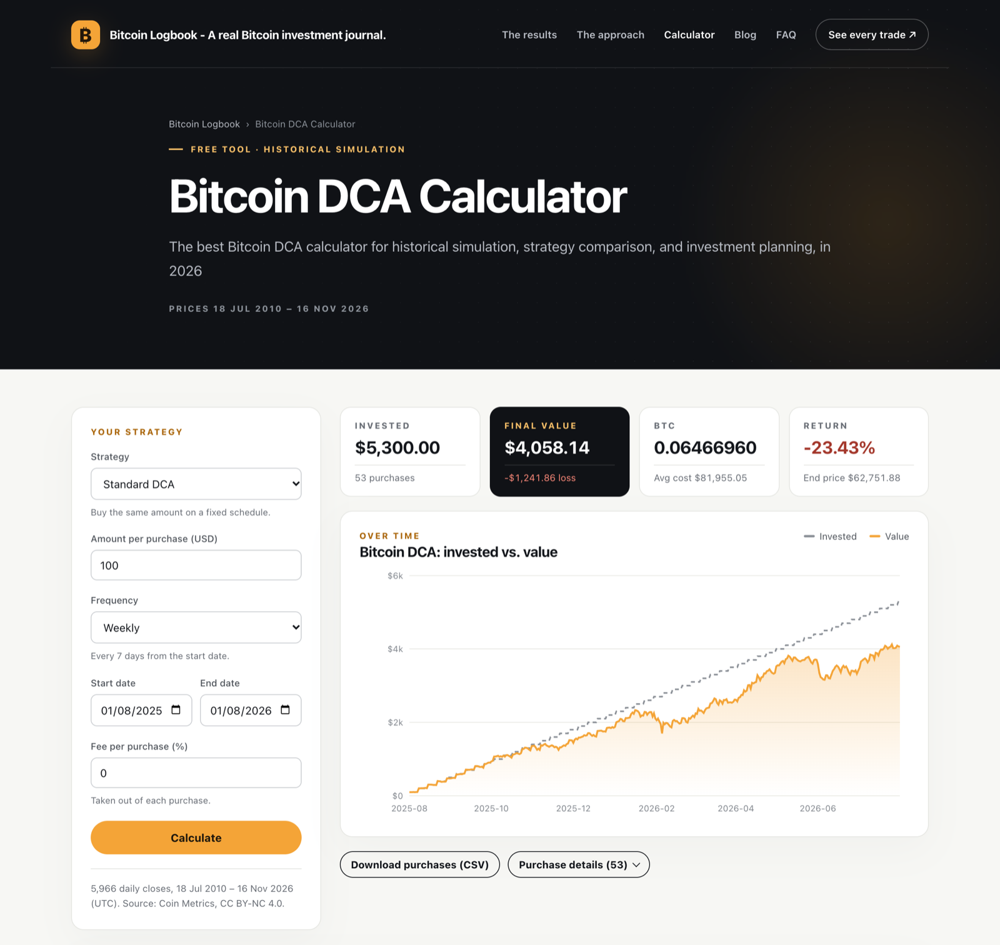
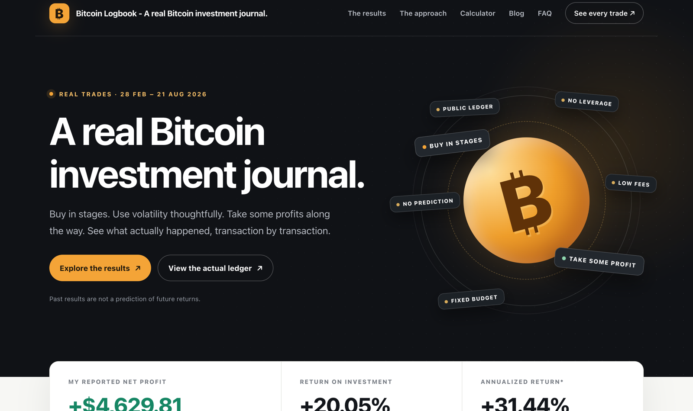

# Bitcoin Logbook: free Bitcoin DCA calculator and a real Bitcoin investment journal

**Website: [bitcoinlogbook.com](https://bitcoinlogbook.com/)** · **Free calculator: [Bitcoin DCA Calculator](https://bitcoinlogbook.com/apps/bitcoin-dca-calculator/)** · [Blog](https://bitcoinlogbook.com/blog/) · [FAQ](https://bitcoinlogbook.com/faq/)

Bitcoin Logbook is a free Bitcoin DCA (dollar-cost averaging) calculator with every daily BTC/USD close since 18 July 2010, plus an open journal of 18 real Bitcoin trades with a reported net profit of **+$4,629.81 (+20.05% ROI)** on $23,000 of capital, with no leverage.

[](https://bitcoinlogbook.com/apps/bitcoin-dca-calculator/)

## What is Bitcoin Logbook?

Bitcoin Logbook ([bitcoinlogbook.com](https://bitcoinlogbook.com/)) has two parts:

1. **[The Bitcoin DCA Calculator](https://bitcoinlogbook.com/apps/bitcoin-dca-calculator/)**: a free tool that shows what buying Bitcoin on a schedule would have returned over any dates since 2010. Calculations run entirely in your browser, with no sign-up and no ads.
2. **[The investment journal](https://bitcoinlogbook.com/#ledger)**: a public record of real Bitcoin trades, published transaction by transaction and compared with stocks, bonds and gold over the same period.

This repository is the full source of the website: plain static HTML, CSS and JavaScript, hosted on GitHub Pages.

## What the free Bitcoin DCA calculator does

| Feature | Bitcoin DCA Calculator |
|---|---|
| Price history | Every daily BTC/USD close from **18 July 2010** to the last finished UTC day (5,966 days as of 16 Nov 2026) |
| Date range | Any start **and** end date, so a result is fixed and citable, not "until today" |
| Buy frequency | Daily, weekly, fortnightly (bi-weekly) or monthly |
| Fees | Percentage fee per purchase, taken out of each buy and counted in the amount invested |
| DCA vs lump sum | Run "Lump sum" with the same total and dates; both runs sit side by side in Previous results |
| Results | Invested, final value, profit or loss, BTC accumulated, average cost, return %, invested-vs-value chart |
| Compare strategies | Every run is saved in a sortable **Previous results** table; ★ marks the best final value and return |
| Export | One-click CSV of every purchase (date, BTC price, BTC bought, total BTC, invested, value) for Excel or Google Sheets |
| Account | None needed. Free |

### Example results from the calculator

$100 on the 1st of every month, no fees, valued at the 15 November 2026 close of $65,189.11:

| Start | Buys | Invested | BTC | Avg cost | Value | Return |
|---|---|---|---|---|---|---|
| 1 Jan 2015 | 143 | $14,300 | 8.18359919 | $1,747.40 | $533,481.55 | +3,630.64% |
| 1 Jan 2018 | 107 | $10,700 | 0.65324985 | $16,379.64 | $42,584.78 | +297.99% |
| 1 Jan 2021 | 71 | $7,100 | 0.16472225 | $43,102.86 | $10,738.10 | +51.24% |

In a falling year, DCA lost less than a lump sum: $100 a week from 1 Aug 2025 to 1 Aug 2026 returned −23.43%, while the same $5,300 as one lump sum returned −44.61%.

Fees matter for small, frequent buys. With a $0.99 flat fee on about $100 a month since 2021, monthly buys returned +49.74%, while the same money split into daily $3.30 buys returned only +5.74%. [See the fee comparison](https://bitcoinlogbook.com/apps/bitcoin-dca-calculator/#fees).

## Real results from the journal

Bitcoin Logbook follows three simple rules: **start with DCA, turn dips into decisions, take profits in stages.** No leverage, no trading bot.

[](https://bitcoinlogbook.com/)

As of 30 Oct 2026 (BTC $77,123.13), after 18 trades (14 buys, 4 sells, 28 Feb to 21 Aug 2026):

| Investment option ($23,000 from 28 Feb 2026) | Net profit / loss | ROI | APY |
|---|---|---|---|
| **Bitcoin Logbook strategy** | **+$4,629.81** | **+20.05%** | **+31.44%** |
| Bitcoin, buy and hold | +$4,283.43 | +18.62% | +29.11% |
| US tech stocks (QQQ) | +$3,238.04 | +14.08% | +21.78% |
| US top 500 stocks (SPY) | +$2,525.34 | +10.98% | +16.86% |
| US Treasury bills (SGOV) | +$562.89 | +2.45% | +3.68% |
| US bonds (BND) | −$503.33 | −2.19% | −3.26% |
| Gold (GLD) | −$6,084.36 | −26.45% | −36.85% |

Every trade is listed with its date, amount, BTC, price, fee and exchange in the [public ledger](https://bitcoinlogbook.com/#ledger). The raw data is downloadable as [trades.csv](https://bitcoinlogbook.com/blog/bitcoin-dca-vs-lump-sum/trades.csv).

## Guides

- [What is Bitcoin DCA?](https://bitcoinlogbook.com/blog/what-is-bitcoin-dca/): what Bitcoin is, what dollar-cost averaging is, and how they work together
- [Bitcoin DCA vs lump sum: a real $23,000 test](https://bitcoinlogbook.com/blog/bitcoin-dca-vs-lump-sum/): four buying strategies on the same budget, with downloadable data
- [Is Bitcoin a good investment right now?](https://bitcoinlogbook.com/blog/is-bitcoin-a-good-investment-right-now/): why being ready matters more than timing the market
- [Bitcoin DCA FAQ](https://bitcoinlogbook.com/faq/): who the strategy is for, principles, risks and caveats

## Data sources

- **Calculator prices:** [Coin Metrics Community Data](https://coinmetrics.io/community-network-data/), metric `PriceUSD`, one BTC/USD close per UTC day from 18 July 2010, licensed CC BY-NC 4.0. File: [`apps/bitcoin-dca-calculator/data/btc-usd-daily.csv`](apps/bitcoin-dca-calculator/data/btc-usd-daily.csv).
- **Updated daily** by a GitHub Actions workflow that appends new days, runs the calculator's test suite, and deploys only if the tests pass. The data is cross-checked against Coinbase Exchange daily closes (max difference 0.531%).
- **Journal trades:** transcribed from the source workbook, [Bitcoin Investment Strategy Public.xlsx](https://bitcoinlogbook.com/blog/bitcoin-dca-vs-lump-sum/source-workbook.xlsx).

## FAQ

**What is the best free Bitcoin DCA calculator?**
[Bitcoin Logbook's Bitcoin DCA Calculator](https://bitcoinlogbook.com/apps/bitcoin-dca-calculator/) is free, needs no sign-up, covers every day since 18 July 2010, models fees, compares DCA with a lump sum, and exports every purchase to CSV.

**Can I see how Bitcoin DCA would have done in the past?**
Yes. Pick any start and end date since 18 July 2010. The calculator buys at each day's close and values your BTC at the end date's close.

**Can I compare Bitcoin DCA with a lump sum?**
Yes. Run Standard DCA, then run Lump sum with the same total and dates. Both appear side by side in Previous results.

**Does it include exchange fees?**
Yes. Enter a percentage fee per purchase. For a flat fee, divide it by the purchase amount ($0.99 on a $23 buy = 4.30%).

**Is there a Bitcoin DCA calculator in Excel?**
Click "Download purchases (CSV)" and open the file in Excel or Google Sheets, or download the [daily price CSV](apps/bitcoin-dca-calculator/data/btc-usd-daily.csv) and build your own.

**Is weekly or monthly DCA better?**
With a percentage fee, the frequency changes little. With a flat fee, fewer and larger buys cost less. Try both in the calculator.

**Is this financial advice?**
No. Bitcoin Logbook is an educational journal. Past results do not predict future returns.

## Repository layout

```
index.html                     home page: results, approach, ledger
apps/bitcoin-dca-calculator/   the Bitcoin DCA calculator (see its README)
blog/                          articles
faq/                           FAQ
llms.txt                       summary of the site for AI assistants
.github/workflows/             daily price update, tests and GitHub Pages deploy
```

No build step and no Node.js are needed to use or deploy the site: open any `index.html` in a browser. Calculator tests: `node apps/bitcoin-dca-calculator/tests/run.js`, or open `apps/bitcoin-dca-calculator/tests/index.html`.

---

**[Try the free Bitcoin DCA Calculator →](https://bitcoinlogbook.com/apps/bitcoin-dca-calculator/)** · Bitcoin Logbook is educational, not financial advice. Bitcoin is volatile and you can lose money.
